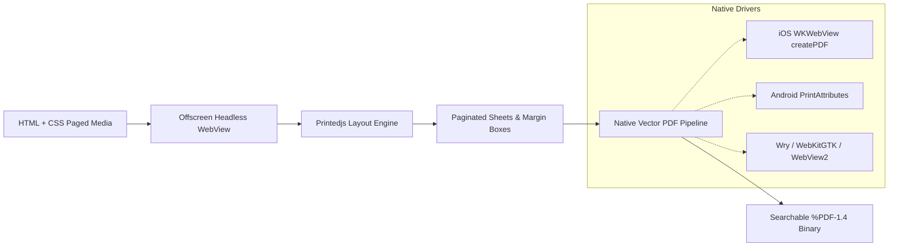

`@printedjs/headless-webview` provides an off-screen headless WebView runtime and native vector PDF engine for **React Native** (iOS, Android, macOS, Windows) and **.NET 8+** (MAUI, WinUI, WPF).

It allows mobile and desktop applications to generate high-resolution, searchable vector PDFs directly on the user's device without requiring remote servers, cloud rendering services, or heavy Chromium daemons.

---

## Architectural Workflow



By pairing `@printedjs/headless-webview` with `@printedjs/minimal`, mobile and desktop apps gain full W3C Paged Media pagination with zero external cloud dependencies.

---

## Supported Platforms & Engines

`@printedjs/headless-webview` provides high-performance native off-screen webview drivers across two primary ecosystems:

### React Native Ecosystem (`@printedjs/headless-webview`)

Available for mobile and desktop applications built with React Native:

| Platform              | Target System              | Underlying Engine                            | Integration Architecture                 | Binary Distribution                     |
| :-------------------- | :------------------------- | :------------------------------------------- | :--------------------------------------- | :-------------------------------------- |
| **iOS**               | iOS `>= 12.0`              | `WKWebView` (`createPDF`)                    | TurboModule (New Arch) & Bridge (Legacy) | Built-in OS WebKit                      |
| **Android**           | Android `>= API 24`        | `android.webkit.WebView` (`PrintAttributes`) | TurboModule (New Arch) & Bridge (Legacy) | Built-in OS WebView                     |
| **Desktop (macOS)**   | macOS `10.15+` (x64/arm64) | Wry (`WebKit`)                               | Desktop Native Bridge                    | Bundled in `bin/darwin-*`               |
| **Desktop (Windows)** | Windows 10/11 (x64/arm64)  | Wry (`WebView2`)                             | Desktop Native Bridge                    | Bundled in `bin/win32-*`                |
| **Desktop (Linux)**   | Linux (x64)                | Wry (`WebKitGTK`)                            | Desktop Native Bridge                    | Bundled in `bin/linux-x64` <sup>*</sup> |

<div class="text-sm text-neutral-500 mt-2">
  * On Linux desktop and server/headless environments, WebKitGTK and an X11 display (or Xvfb) are required. See <a href="#headless-linux--docker-environments-xvfb" class="text-sky-500 hover:underline">Headless Linux & Docker Environments</a> below.
</div>

### .NET Ecosystem (`PrintedJs.HeadlessWebView`)

Available for cross-platform .NET 8+ desktop, MAUI, and server workloads:

| Platform        | Target System              | Underlying Engine | Integration Architecture          | Native Runtime Library                 |
| :-------------- | :------------------------- | :---------------- | :-------------------------------- | :------------------------------------- |
| **macOS (OSX)** | macOS `10.15+` (x64/arm64) | Wry (`WebKit`)    | UniFFI Rust Core + C-ABI P/Invoke | `libprintedjs_webview.dylib`           |
| **Linux**       | Linux (x64/arm64)          | Wry (`WebKitGTK`) | UniFFI Rust Core + C-ABI P/Invoke | `libprintedjs_webview.so` <sup>*</sup> |
| **Windows**     | Windows 10/11 (x64/arm64)  | Wry (`WebView2`)  | UniFFI Rust Core + C-ABI P/Invoke | `printedjs_webview.dll`                |

<div class="text-sm text-neutral-500 mt-2">
  * On headless Linux servers or container environments, run .NET binaries with Xvfb virtual display.
</div>

---

## Installation

### React Native

```bash
pnpm add @printedjs/headless-webview
# or
npm install @printedjs/headless-webview
```

#### iOS Setup

For CocoaPods:

```bash
cd ios && pod install
```

Swift Package Manager (`Package.swift`) is also supported out of the box with zero manual configuration. The module links cleanly as standard Objective-C/C++ without Swift runtime overhead.

#### Android Setup

Autolinking automatically registers `HeadlessWebViewPackage`. Ensure `minSdkVersion = 24` in `android/build.gradle`.

#### Desktop (macOS, Windows, Linux)

Prebuilt native binaries are bundled directly under `bin/` inside the package.

> [!NOTE]
> On Linux desktop and server/Docker environments, WebKitGTK and Xvfb are required. See [Headless Linux & Docker Environments](#headless-linux--docker-environments-xvfb) below.

### .NET (NuGet)

```bash
dotnet add package PrintedJs.HeadlessWebView
```

---

## React Native Usage

### The `useHeadlessWebView` Hook

The `useHeadlessWebView` hook provides reactive lifecycle management, HTML rendering, DOM settlement polling, and vector PDF export:

```tsx
import React, { useState } from "react";
import { View, Button, Text, ActivityIndicator } from "react-native";
import { useHeadlessWebView } from "@printedjs/headless-webview";

export function InvoiceExportScreen() {
	const [pdfSize, setPdfSize] = useState<number | null>(null);

	const { isReady, isBusy, error, printToPdf, waitForFunction } = useHeadlessWebView({
		html: `
      <!DOCTYPE html>
      <html>
        <head>
          <script src="https://cdn.jsdelivr.net/npm/@printedjs/minimal/dist/index.min.global.js"></script>
          <style>
            @page {
              size: A4;
              margin: 20mm;
              @top-center { content: "INVOICE #2026-001"; font-family: sans-serif; font-size: 8pt; color: #64748b; }
              @bottom-right { content: "Page " counter(page) " of " counter(pages); font-size: 8pt; }
            }
            body { font-family: sans-serif; color: #0f172a; }
            h1 { color: #0284c7; }
          </style>
        </head>
        <body>
          <h1>Customer Invoice</h1>
          <p>Generated directly on-device with zero cloud latency.</p>
        </body>
      </html>
    `,
	});

	const handleExport = async () => {
		if (!isReady) return;

		// Wait for Printedjs layout pagination and fonts to settle
		await waitForFunction(() => window.__printedjsRenderFinished === true, {
			timeoutMs: 10000,
			pollingIntervalMs: 50,
		});

		const pdfBytes = await printToPdf({
			landscape: false,
			pageWidth: 8.27, // A4 width in inches
			pageHeight: 11.69, // A4 height in inches
			printBackground: true,
		});

		setPdfSize(pdfBytes.length);
	};

	return (
		<View style={{ padding: 24, gap: 12 }}>
			<Button
				title={isBusy ? "Generating Vector PDF..." : "Export Invoice PDF"}
				onPress={handleExport}
				disabled={!isReady || isBusy}
			/>
			{isBusy && <ActivityIndicator color="#0284c7" />}
			{pdfSize !== null && <Text>PDF Generated: {pdfSize} bytes</Text>}
			{error && <Text style={{ color: "red" }}>Error: {error.message}</Text>}
		</View>
	);
}
```

### Standalone Headless Service

For background jobs, queue processors, or CLI tasks outside React component trees:

```typescript
import { HeadlessWebView } from "@printedjs/headless-webview";

const webview = await HeadlessWebView.create({
	html: "<h1>Automated Report</h1>",
});

try {
	await webview.waitForFunction(() => document.readyState === "complete");

	const pdfBytes = await webview.printToPdf({
		landscape: false,
		pageWidth: 8.27,
		pageHeight: 11.69,
		printBackground: true,
	});

	console.log(`Generated PDF (${pdfBytes.length} bytes)`);
} finally {
	await webview.destroy();
}
```

### Enabling Desktop Native Bridge

When running on React Native Desktop (macOS / Windows), call `enableDesktopBridge()` before creating a webview:

```typescript
import { enableDesktopBridge, HeadlessWebView } from "@printedjs/headless-webview";

// Binds HeadlessWebView to the bundled prebuilt native desktop Wry engine
enableDesktopBridge();

const webview = await HeadlessWebView.create({
	html: "<h1>Desktop Native Vector PDF</h1>",
});
```

---

## .NET 8+ Usage

In C# .NET MAUI or serverless worker applications:

```csharp
using PrintedJs.HeadlessWebView;

// Create headless webview instance
await using var webview = await HeadlessWebView.CreateAsync(new HeadlessWebViewOptions
{
    Html = "<h1>Enterprise Report</h1><p>Rendered with .NET MAUI and Printedjs.</p>"
});

// Wait for document or scripts to finish
await webview.WaitForFunctionAsync("() => document.readyState === 'complete'");

// Export vector PDF binary
byte[] pdfBytes = await webview.PrintToPdfAsync(new PdfPrintOptions
{
    Landscape = false,
    PageWidth = 8.27,
    PageHeight = 11.69,
    PrintBackground = true
});

await File.WriteAllBytesAsync("report.pdf", pdfBytes);
```

---

## Headless Linux & Docker Environments (Xvfb)

On Linux systems, the underlying WebView engine used by desktop React Native and .NET is **WebKitGTK** (via Wry). WebKitGTK requires a connection to an active X11 display server to initialize its graphics subsystem and rendering contexts—even when executing purely off-screen to generate vector PDF buffers.

In headless environments such as Linux servers, CI/CD runners (e.g., GitHub Actions), and Docker containers, a physical monitor or display server is not available. Running without an active X server will result in `cannot open display` errors.

To run headless on Linux, wrap execution with **Xvfb** (X Virtual Framebuffer).

### Required System Packages (Debian / Ubuntu)

Install the required WebKitGTK 4.1 runtime libraries, fonts, and Xvfb:

```bash
sudo apt-get update && sudo apt-get install -y \
  xvfb \
  libwebkit2gtk-4.1-0 \
  libjavascriptcoregtk-4.1-0 \
  libsoup-3.0-0 \
  ca-certificates \
  fonts-liberation
```

### Running with `xvfb-run`

The simplest way to execute scripts or applications headlessly without managing background server daemons is with the `xvfb-run` wrapper:

```bash
# React Native / Node.js headless export
xvfb-run -a --server-args="-screen 0 1280x1024x24 -ac" node generate-pdf.js

# .NET Headless application
xvfb-run -a --server-args="-screen 0 1280x1024x24 -ac" dotnet run --project ReportGenerator.csproj
```

The `-a` flag automatically allocates a free display number, and `--server-args="-screen 0 1280x1024x24 -ac"` initializes a 24-bit virtual screen.

### Background Xvfb Service (Daemon)

If running a long-running web service or worker queue:

```bash
# Start Xvfb virtual framebuffer on display :99
Xvfb :99 -screen 0 1280x1024x24 -ac +extension GLX +render -noreset &

# Export the display variable
export DISPLAY=:99

# Run your application normally
node server.js
```

### Docker Configuration & Best Practices

When deploying in Docker containers, follow these critical guidelines:

1. **Shared Memory (`--shm-size=1gb` or `--ipc=host`)**: Docker defaults to a 64MB shared memory partition (`/dev/shm`). WebKitGTK uses shared memory for inter-process communication between the UI process and WebKit renderer processes. Complex documents with large images may exhaust 64MB, causing unexpected crashes. Always launch Docker containers with `--shm-size=1gb` or `--ipc=host`.
2. **Disable Hardware Compositing (`WEBKIT_DISABLE_COMPOSITING_MODE=1`)**: In headless virtualized containers without GPU acceleration, WebKitGTK may attempt hardware accelerated compositing and fail. Setting `WEBKIT_DISABLE_COMPOSITING_MODE=1` forces WebKit to use software rasterization, ensuring fast and reliable vector PDF generation.

#### Production Dockerfile Example

```dockerfile
FROM node:20-slim

# 1. Install WebKitGTK and Xvfb dependencies
RUN apt-get update && apt-get install -y --no-install-recommends \
    xvfb \
    libwebkit2gtk-4.1-0 \
    libjavascriptcoregtk-4.1-0 \
    libsoup-3.0-0 \
    ca-certificates \
    fonts-liberation \
    && rm -rf /var/lib/apt/lists/*

# 2. Configure off-screen rendering environment
ENV DISPLAY=:99 \
    WEBKIT_DISABLE_COMPOSITING_MODE=1

WORKDIR /app

# 3. Install application dependencies
COPY package*.json ./
RUN npm ci --omit=dev

COPY . .

# 4. Start Xvfb virtual display before launching the app
CMD Xvfb :99 -screen 0 1280x1024x24 -ac & node server.js
```

Run the container with adequate shared memory:

```bash
docker run -d --shm-size=1gb -p 3000:3000 my-pdf-service
```
