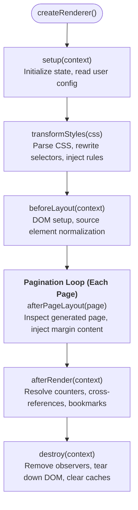

Printedjs features a modular, topological plugin architecture. Core features—such as `@page` rules, margins, footnotes, running headers, and counters—are implemented as composable plugins. You can extend the pagination engine with custom plugins to inject content, manipulate stylesheets, extract metadata, or apply custom layout rules.

## The `PrintedjsPlugin` Interface

A Printedjs plugin is an object implementing the `PrintedjsPlugin` interface defined in `@printedjs/core`:

```typescript
import type { PrintedjsPlugin, PluginContext, PageResult } from "@printedjs/core";

export interface PrintedjsPlugin {
	/** Unique identifier for the plugin */
	name: string;

	/** Optional list of plugin names that must execute before this plugin */
	dependencies?: string[];

	/** Called once before any style transformations or surface mounting */
	setup?(context: PluginContext): void | Promise<void>;

	/** Transforms raw CSS text or AST before injection */
	transformStyles?(css: string, context: PluginContext): string | Promise<string>;

	/** Called after surface mounting but before pagination commences */
	beforeLayout?(context: PluginContext): void | Promise<void>;

	/** Called immediately after an individual page has finished layout */
	afterPageLayout?(page: PageResult, context: PluginContext): void | Promise<void>;

	/** Called after all pages have finished layout and post-processing */
	afterRender?(context: PluginContext): void | Promise<void>;

	/** Cleanup hook called when renderer.destroy() is invoked */
	destroy?(context: PluginContext): void | Promise<void>;
}
```

---

## Lifecycle Execution Flow

The renderer executes plugin hooks in deterministic topological order:



---

## Example 1: Custom Watermark Plugin

Here is a practical plugin that adds a diagonal "CONFIDENTIAL" watermark to every rendered page:

```typescript
import type { PrintedjsPlugin, PluginContext } from "@printedjs/core";

export function watermarkPlugin(text: string = "CONFIDENTIAL"): PrintedjsPlugin {
	return {
		name: "watermark-plugin",
		dependencies: ["page-rules"], // Run after page geometry is established

		transformStyles(css: string): string {
			const watermarkStyles = `
        .printedjs_watermark {
          position: absolute;
          inset: 0;
          display: flex;
          align-items: center;
          justify-content: center;
          font-size: 64pt;
          font-weight: 800;
          color: rgba(148, 163, 184, 0.15);
          transform: rotate(-35deg);
          pointer-events: none;
          user-select: none;
          z-index: 10;
        }
      `;
			return css + watermarkStyles;
		},

		afterPageLayout(page, context: PluginContext) {
			const doc = context.metadata["document"] as Document | undefined;
			if (!doc || !page.element) return;

			const pagebox = page.element.querySelector(".printedjs_pagebox") ?? page.element;
			const watermark = doc.createElement("div");
			watermark.className = "printedjs_watermark";
			watermark.textContent = text;
			pagebox.appendChild(watermark);
		},
	};
}
```

---

## Example 2: Heading Outline & Bookmark Extractor

This plugin extracts all `<h1>` through `<h3>` headings across pages and stores a table of contents outline in the `PluginContext.metadata` dictionary:

```typescript
import type { PrintedjsPlugin, PluginContext } from "@printedjs/core";

export interface OutlineItem {
	level: number;
	title: string;
	id: string;
	pageNumber: number;
}

export function outlineExtractorPlugin(): PrintedjsPlugin {
	return {
		name: "outline-extractor",

		afterRender(context: PluginContext) {
			const doc = context.metadata["document"] as Document | undefined;
			if (!doc) return;

			const outline: OutlineItem[] = [];
			const pages = doc.querySelectorAll<HTMLElement>(".printedjs_page");

			pages.forEach((pageEl, pageIdx) => {
				const headings = pageEl.querySelectorAll<HTMLHeadingElement>("h1, h2, h3");
				headings.forEach((h) => {
					outline.push({
						level: Number(h.tagName.substring(1)),
						title: h.textContent?.trim() ?? "",
						id: h.id || `heading-${outline.length}`,
						pageNumber: pageIdx + 1,
					});
				});
			});

			// Expose the outline on context metadata for caller consumption
			context.metadata["documentOutline"] = outline;
		},
	};
}
```

---

## Registering Plugins with the Renderer

Pass your custom plugins to `createRenderer`:

```typescript
import { createRenderer } from "@printedjs/browser";
import { standardPreset } from "@printedjs/plugins";
import { watermarkPlugin } from "./watermark-plugin";
import { outlineExtractorPlugin } from "./outline-plugin";

const renderer = createRenderer({
	target: document.querySelector("#preview")!,
	plugins: [
		...standardPreset(),
		watermarkPlugin("DRAFT PREVIEW"),
		outlineExtractorPlugin(),
	],
});

const result = await renderer.render({ content: { html } });
```
