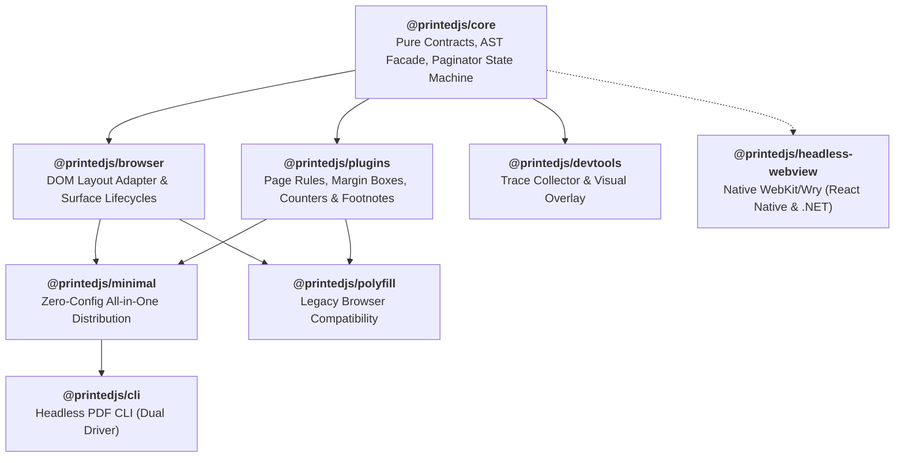
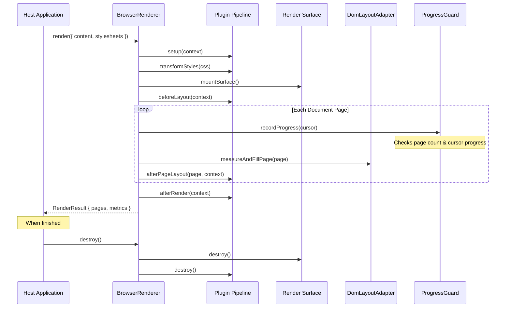

Printedjs is a high-performance, modular TypeScript engine for browser-native paginated document rendering. It replaces legacy monolithic Paged.js with a multi-package architecture, strict separation of concerns, resilient loop protection, and comprehensive CSS Paged Media standards compliance.

## 1. Architectural Philosophy

Printedjs is built around four fundamental design tenets:

1. **Decoupled Core Architecture (`@printedjs/core`):** Pure state machines, error taxonomy, CSS AST parsing (`css-tree`), and paginator contracts belong in a platform-agnostic core package with zero references to `window`, `document`, or browser CSSOM. Layout, geometry measurement, and DOM mutations are cleanly isolated in `@printedjs/browser`, which executes inside browser or headless WebView environments.
2. **Surface Isolation:** Rendered documents must never pollute host applications. Printedjs supports both in-place (`root`) and sandboxed (`iframe`) execution with guaranteed, residue-free teardown.
3. **Resilient Pagination Guard:** Documents with contradictory layout constraints or overflowing unbreakable blocks must never cause browser lockups or infinite render loops.
4. **Deterministic Plugin Pipeline:** Features such as margin boxes, running headers, footnotes, and counters are implemented as composable plugins with topological dependency resolution.

---

## 2. Monorepo Package Map

---

## 3. Render Lifecycle Sequence

The sequence diagram below details the exact pipeline of operations during a render invocation:

---

## 4. DOM & CSS Conventions

- **Page Shell:** Each page box is structured with an outer `.printedjs_page`, containing `.printedjs_sheet`, `.printedjs_pagebox`, and standard margin boxes (`.printedjs_margin-top-left`, etc.).
- **CSS Custom Properties:** Sheet dimensions, bleed, and margins are stored on standard CSS variables (e.g., `--printedjs-width`, `--printedjs-height`, `--printedjs-margin-top`).
- **Compatibility Mode:** When `pagedjsCompatible: true` is configured, Printedjs emits both modern `.printedjs_*` classes and legacy `.pagedjs_*` classes, ensuring backward compatibility with existing print stylesheets.
