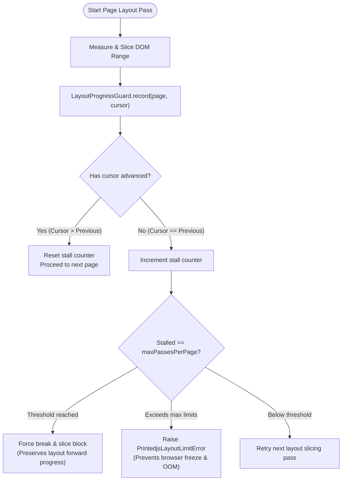

A primary cause of browser tab crashes in legacy pagination engines (such as monolithic Paged.js) is the infinite page generation loop. Printedjs solves this fundamentally through its core `LayoutProgressGuard` state machine.

## The Infinite Loop Problem

In complex real-world documents, conflicting CSS constraints frequently create impossible pagination states:

1. **Oversized Unbreakable Elements:** A table row, code block, or illustration with `break-inside: avoid` that is taller than the available printable page box (`page-height - margins`).
2. **Cyclical Break Rules:** Contradictory rules such as `h2 { break-before: avoid }` followed immediately by a sibling with `break-before: page`.
3. **Zero-Advance Break Tokens:** An element is pushed to the next page because it doesn't fit on the current page, but immediately fails to fit on the next empty page as well, generating thousands of empty pages until browser memory is exhausted.

---

## How `LayoutProgressGuard` Protects the Engine

`LayoutProgressGuard` operates as an active supervisor inside the pagination loop:



---

## Guard Mechanisms

### 1. Cursor & Break Token Tracking

After every layout slicing pass, `LayoutProgressGuard` records the absolute DOM node offset and text character cursor. If the cursor position does not advance from the previous pass, the guard increments an internal stall counter.

### 2. Forced Breaking & Overflow Truncation

When an element marked with `break-inside: avoid` exceeds the height of an entire blank page, adhering strictly to CSS rules would prevent any pagination. Instead of looping infinitely, the guard temporarily relaxes the avoid constraint and forces a split, ensuring the document can continue progressing toward completion.

### 3. Configurable Limits

Developers can configure safety thresholds on the renderer:

```typescript
const renderer = createRenderer({
	target: container,
	plugins: standardPreset(),
	limits: {
		maxPages: 500, // Maximum allowable pages before throwing
		maxPassesPerPage: 10, // Maximum layout retry passes per sheet
	},
});
```

---

## Typed Error Taxonomy

Printedjs exports a clean hierarchy of typed errors derived from `PrintedjsError`:

```typescript
import {
	PrintedjsError,
	PrintedjsLayoutLimitError,
	PrintedjsInputError,
	PrintedjsStylesheetError,
	PrintedjsAbortError,
} from "@printedjs/core";

try {
	await renderer.render({ content: { html } });
} catch (error) {
	if (error instanceof PrintedjsLayoutLimitError) {
		console.error(`Layout limit exceeded: ${error.message} (Page limit: ${error.limit})`);
	} else if (error instanceof PrintedjsAbortError) {
		console.warn("Render operation was cancelled via AbortSignal");
	} else if (error instanceof PrintedjsStylesheetError) {
		console.error(`CSS parsing failed in stylesheet: ${error.url}`);
	}
}
```
