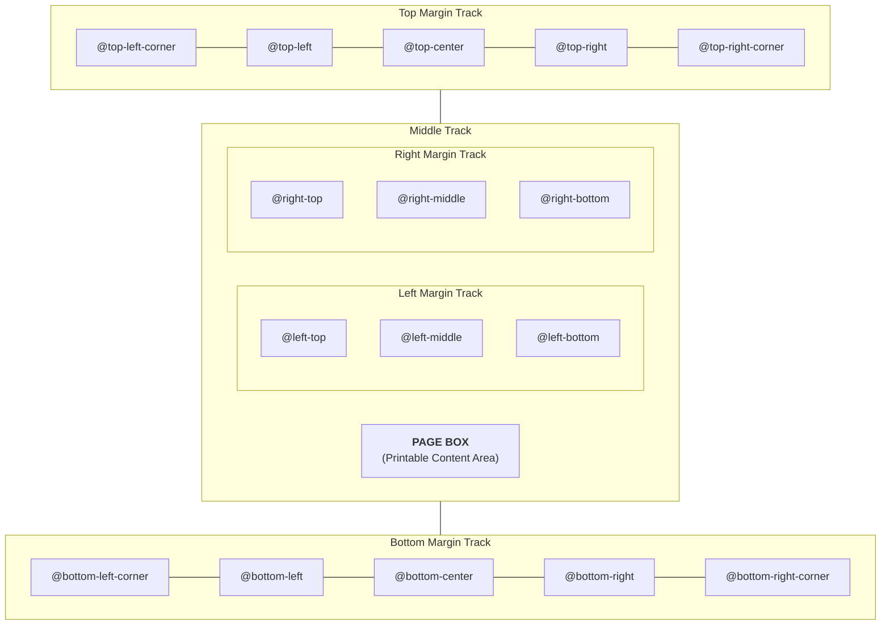

The `@page` at-rule defines page dimensions, margins, bleed allowances, crop marks, and perimeter margin box areas across physical document sheets.

## Page Sizing & Orientation

Define basic page geometry in CSS:

```css
@page {
	/* Standard paper size and orientation */
	size: A4 portrait; /* or 'letter', 'legal', 'A3', 'landscape' */

	/* Uniform or distinct margins */
	margin: 25mm 20mm 25mm 20mm;

	/* Print bleed and printer registration marks */
	bleed: 3mm;
	marks: crop cross;
}
```

::feature-preview{feature="page-rules-basic"}
::

### Supported Paper Sizes

Printedjs supports standard keyword paper sizes as well as custom dimensional units:

- **Standard Sizes:** `A4`, `A3`, `A5`, `letter`, `legal`, `ledger`.
- **Custom Dimensions:** `size: 210mm 297mm;` or `size: 8.5in 11in;`.
- **Orientation:** `portrait` (default) or `landscape` (e.g. `size: letter landscape`).

---

## Page Pseudo-Classes & Facing Spreads

Printedjs supports W3C page pseudo-classes for books, brochures, and reports:

```css
/* Cover page styling: zero margin, no headers or footers */
@page :first {
	margin: 0;
	@top-left {
		content: none;
	}
	@bottom-right {
		content: none;
	}
}

/* Left (verso / even) pages */
@page :left {
	margin-left: 30mm; /* Wider outside margin */
	margin-right: 20mm; /* Narrower binding gutter */
	@bottom-left {
		content: counter(page);
	}
}

/* Right (recto / odd) pages */
@page :right {
	margin-left: 20mm; /* Narrower binding gutter */
	margin-right: 30mm; /* Wider outside margin */
	@bottom-right {
		content: counter(page);
	}
}

/* Automatically inserted blank pages */
@page :blank {
	@top-center {
		content: "This page intentionally left blank";
		font-style: italic;
		color: #94a3b8;
	}
}
```

### Mirrored Margins & Gutter Binding

Printedjs supports high-end bookbinding properties directly:

```css
@page {
	size: A4;
	margin-inside: 25mm; /* Binding margin (left on recto, right on verso) */
	margin-outside: 15mm; /* Outer edge margin */
	gutter: 5mm; /* Extra spine allowance for physical binding */
}
```

---

## 16 CSS Margin Boxes

W3C CSS Paged Media defines 16 perimeter margin boxes surrounding the printable page box (`pagebox`):



::feature-preview{feature="page-rules-margins"}
::

### Example: Running Headers, Confidential Watermark & Pagination

```css
@page {
	size: letter;
	margin: 20mm 18mm;

	@top-left {
		content: "Confidential Enterprise Audit";
		font-size: 8pt;
		font-weight: 600;
		color: #64748b;
	}

	@top-right {
		content: string(chapter-title);
		font-size: 8pt;
		color: #64748b;
	}

	@bottom-left {
		content: "Distribution Channel: Internal Only";
		font-size: 7.5pt;
		color: #94a3b8;
	}

	@bottom-right {
		content: "Page " counter(page) " of " counter(pages);
		font-size: 8pt;
		font-weight: 500;
		color: #0284c7;
	}
}
```

---

## Named Pages

You can apply specific page templates to distinct sections of your document:

```css
@page landscape-table {
	size: A4 landscape;
	margin: 15mm;
	@top-right {
		content: "Landscape Financial Matrix";
	}
}

.wide-financial-section {
	page: landscape-table;
}
```
