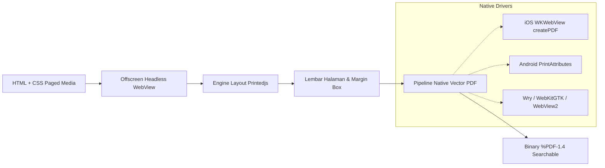

`@printedjs/headless-webview` menyediakan runtime headless WebView off-screen dan engine vector PDF native untuk **React Native** (iOS, Android, macOS, Windows) serta **.NET 8+** (MAUI, WinUI, WPF).

Paket ini memungkinkan aplikasi mobile dan desktop menghasilkan file PDF berbasis vektor beresolusi tinggi langsung di perangkat pengguna tanpa memerlukan server remote, layanan cloud, atau browser Chromium.

---

## Alur Kerja Arsitektur



Kombinasi antara `@printedjs/headless-webview` dan `@printedjs/minimal` memberikan kemampuan pagination dokumen standar W3C Paged Media yang lengkap tanpa ketergantungan pada server pihak ketiga.

---

## Dukungan Platform & Engine

`@printedjs/headless-webview` menyediakan driver webview off-screen native berperforma tinggi untuk dua ekosistem utama:

### Ekosistem React Native (`@printedjs/headless-webview`)

Tersedia untuk aplikasi mobile dan desktop yang dibangun dengan React Native:

| Platform              | Sistem Target              | Engine WebView                               | Arsitektur Integrasi                     | Distribusi Biner                         |
| :-------------------- | :------------------------- | :------------------------------------------- | :--------------------------------------- | :--------------------------------------- |
| **iOS**               | iOS `>= 12.0`              | `WKWebView` (`createPDF`)                    | TurboModule (New Arch) & Bridge (Legacy) | Native WebKit (Bawaan OS)                |
| **Android**           | Android `>= API 24`        | `android.webkit.WebView` (`PrintAttributes`) | TurboModule (New Arch) & Bridge (Legacy) | Native WebView (Bawaan OS)               |
| **Desktop (macOS)**   | macOS `10.15+` (x64/arm64) | Wry (`WebKit`)                               | Desktop Native Bridge                    | Prebuilt di `bin/darwin-*`               |
| **Desktop (Windows)** | Windows 10/11 (x64/arm64)  | Wry (`WebView2`)                             | Desktop Native Bridge                    | Prebuilt di `bin/win32-*`                |
| **Desktop (Linux)**   | Linux (x64)                | Wry (`WebKitGTK`)                            | Desktop Native Bridge                    | Prebuilt di `bin/linux-x64` <sup>*</sup> |

<div class="text-sm text-neutral-500 mt-2">
  * Pada desktop Linux dan lingkungan server/headless, WebKitGTK dan display X11 (atau Xvfb) diperlukan. Lihat bagian <a href="#lingkungan-headless-linux--docker-xvfb" class="text-sky-500 hover:underline">Lingkungan Headless Linux & Docker</a> di bawah.
</div>

### Ekosistem .NET (`PrintedJs.HeadlessWebView`)

Tersedia untuk desktop lintas platform .NET 8+, MAUI, dan beban kerja server:

| Platform        | Sistem Target              | Engine WebView    | Arsitektur Integrasi              | Library Runtime Native                 |
| :-------------- | :------------------------- | :---------------- | :-------------------------------- | :------------------------------------- |
| **macOS (OSX)** | macOS `10.15+` (x64/arm64) | Wry (`WebKit`)    | UniFFI Rust Core + C-ABI P/Invoke | `libprintedjs_webview.dylib`           |
| **Linux**       | Linux (x64/arm64)          | Wry (`WebKitGTK`) | UniFFI Rust Core + C-ABI P/Invoke | `libprintedjs_webview.so` <sup>*</sup> |
| **Windows**     | Windows 10/11 (x64/arm64)  | Wry (`WebView2`)  | UniFFI Rust Core + C-ABI P/Invoke | `printedjs_webview.dll`                |

<div class="text-sm text-neutral-500 mt-2">
  * Pada server Linux headless atau lingkungan container, jalankan biner .NET dengan virtual display Xvfb.
</div>

---

## Instalasi

### React Native

```bash
pnpm add @printedjs/headless-webview
# atau
npm install @printedjs/headless-webview
```

#### Setup iOS

Untuk CocoaPods:

```bash
cd ios && pod install
```

Swift Package Manager (`Package.swift`) juga didukung tanpa konfigurasi manual. Modul ini terhubung langsung menggunakan Objective-C/C++ tanpa overhead runtime Swift.

#### Setup Android

Fitur autolinking langsung mendaftarkan `HeadlessWebViewPackage`. Pastikan `minSdkVersion = 24` pada file `android/build.gradle`.

#### Desktop (macOS, Windows, Linux)

Biner native bawaan sudah disertakan di folder `bin/` dalam paket npm.

> [!NOTE]
> Pada desktop Linux dan lingkungan server/Docker, WebKitGTK dan Xvfb diperlukan. Lihat bagian [Lingkungan Headless Linux & Docker](#lingkungan-headless-linux--docker-xvfb) di bawah.

### .NET (NuGet)

```bash
dotnet add package PrintedJs.HeadlessWebView
```

---

## Penggunaan di React Native

### Hook `useHeadlessWebView`

Hook `useHeadlessWebView` menyediakan manajemen lifecycle reaktif, rendering HTML, polling kesiapan dokumen, dan ekspor vector PDF:

```tsx
import React, { useState } from "react";
import { View, Button, Text, ActivityIndicator } from "react-native";
import { useHeadlessWebView } from "@printedjs/headless-webview";

export function InvoiceExportScreen() {
	const [pdfSize, setPdfSize] = useState<number | null>(null);

	const { isReady, isBusy, error, printToPdf, waitForFunction } = useHeadlessWebView({
		html: `
      <!DOCTYPE html>
      <html>
        <head>
          <script src="https://cdn.jsdelivr.net/npm/@printedjs/minimal/dist/index.min.global.js"></script>
          <style>
            @page {
              size: A4;
              margin: 20mm;
              @top-center { content: "INVOICE #2026-001"; font-family: sans-serif; font-size: 8pt; color: #64748b; }
              @bottom-right { content: "Halaman " counter(page) " dari " counter(pages); font-size: 8pt; }
            }
            body { font-family: sans-serif; color: #0f172a; }
            h1 { color: #0284c7; }
          </style>
        </head>
        <body>
          <h1>Faktur Pelanggan</h1>
          <p>Dibuat langsung di perangkat pengguna tanpa server eksternal.</p>
        </body>
      </html>
    `,
	});

	const handleExport = async () => {
		if (!isReady) return;

		// Menunggu pagination layout Printedjs dan web font selesai dimuat
		await waitForFunction(() => window.__printedjsRenderFinished === true, {
			timeoutMs: 10000,
			pollingIntervalMs: 50,
		});

		const pdfBytes = await printToPdf({
			landscape: false,
			pageWidth: 8.27, // Lebar A4 dalam inci
			pageHeight: 11.69, // Tinggi A4 dalam inci
			printBackground: true,
		});

		setPdfSize(pdfBytes.length);
	};

	return (
		<View style={{ padding: 24, gap: 12 }}>
			<Button
				title={isBusy ? "Membuat Vector PDF..." : "Ekspor PDF Faktur"}
				onPress={handleExport}
				disabled={!isReady || isBusy}
			/>
			{isBusy && <ActivityIndicator color="#0284c7" />}
			{pdfSize !== null && <Text>PDF Berhasil Dibuat: {pdfSize} bytes</Text>}
			{error && <Text style={{ color: "red" }}>Error: {error.message}</Text>}
		</View>
	);
}
```

### Service Mandiri (HeadlessWebView)

Untuk proses background, worker queue, atau operasi non-komponen:

```typescript
import { HeadlessWebView } from "@printedjs/headless-webview";

const webview = await HeadlessWebView.create({
	html: "<h1>Laporan Otomatis</h1>",
});

try {
	await webview.waitForFunction(() => document.readyState === "complete");

	const pdfBytes = await webview.printToPdf({
		landscape: false,
		pageWidth: 8.27,
		pageHeight: 11.69,
		printBackground: true,
	});

	console.log(`PDF berhasil dibuat: ${pdfBytes.length} bytes`);
} finally {
	await webview.destroy();
}
```

### Mengaktifkan Bridge Desktop

Saat dijalankan di React Native Desktop (macOS / Windows), panggil `enableDesktopBridge()` sebelum membuat instance webview:

```typescript
import { enableDesktopBridge, HeadlessWebView } from "@printedjs/headless-webview";

// Menghubungkan HeadlessWebView ke engine Wry bawaan desktop
enableDesktopBridge();

const webview = await HeadlessWebView.create({
	html: "<h1>Desktop Native Vector PDF</h1>",
});
```

---

## Penggunaan di .NET 8+

Untuk aplikasi C# .NET MAUI atau server worker:

```csharp
using PrintedJs.HeadlessWebView;

// Membuat instance headless webview
await using var webview = await HeadlessWebView.CreateAsync(new HeadlessWebViewOptions
{
    Html = "<h1>Laporan Enterprise</h1><p>Dirender dengan .NET MAUI dan Printedjs.</p>"
});

// Menunggu dokumen atau script selesai
await webview.WaitForFunctionAsync("() => document.readyState === 'complete'");

// Ekspor binary vector PDF
byte[] pdfBytes = await webview.PrintToPdfAsync(new PdfPrintOptions
{
    Landscape = false,
    PageWidth = 8.27,
    PageHeight = 11.69,
    PrintBackground = true
});

await File.WriteAllBytesAsync("laporan.pdf", pdfBytes);
```

---

## Lingkungan Headless Linux & Docker (Xvfb)

Pada sistem Linux, engine WebView yang digunakan oleh desktop React Native dan .NET adalah **WebKitGTK** (melalui Wry). WebKitGTK membutuhkan koneksi ke server display X11 yang aktif untuk menginisialisasi subsistem grafis dan konteks rendering—bahkan saat mengeksekusi rendering off-screen untuk membuat buffer vector PDF.

Di lingkungan headless seperti server Linux, runner CI/CD (misalnya GitHub Actions), dan container Docker, monitor fisik atau server display tidak tersedia secara default. Menjalankan WebView tanpa server X yang aktif akan menyebabkan error `cannot open display`.

Untuk menjalankan WebView secara headless di Linux, gunakan **Xvfb** (X Virtual Framebuffer).

### Dependensi Paket Sistem (Debian / Ubuntu)

Instal runtime library WebKitGTK 4.1, font sistem, dan paket Xvfb:

```bash
sudo apt-get update && sudo apt-get install -y \
  xvfb \
  libwebkit2gtk-4.1-0 \
  libjavascriptcoregtk-4.1-0 \
  libsoup-3.0-0 \
  ca-certificates \
  fonts-liberation
```

### Menjalankan dengan `xvfb-run`

Cara paling praktis untuk mengeksekusi skrip atau aplikasi headless tanpa mengelola daemon server background adalah menggunakan wrapper `xvfb-run`:

```bash
# Ekspor headless React Native / Node.js
xvfb-run -a --server-args="-screen 0 1280x1024x24 -ac" node generate-pdf.js

# Aplikasi headless .NET
xvfb-run -a --server-args="-screen 0 1280x1024x24 -ac" dotnet run --project ReportGenerator.csproj
```

Flag `-a` otomatis mengalokasikan nomor display yang kosong, dan argumen `--server-args="-screen 0 1280x1024x24 -ac"` menginisialisasi layar virtual 24-bit.

### Layanan Xvfb di Background (Daemon)

Jika menjalankan web service jangka panjang atau antrean worker:

```bash
# Menjalankan framebuffer virtual Xvfb pada display :99
Xvfb :99 -screen 0 1280x1024x24 -ac +extension GLX +render -noreset &

# Ekspor variabel display
export DISPLAY=:99

# Jalankan aplikasi Anda seperti biasa
node server.js
```

### Konfigurasi & Praktik Terbaik Docker

Saat menjalankan di dalam container Docker, perhatikan panduan penting berikut:

1. **Shared Memory (`--shm-size=1gb` atau `--ipc=host`)**: Container Docker secara default hanya mengalokasikan 64MB memori bersama (`/dev/shm`). WebKitGTK memanfaatkan shared memory untuk komunikasi antar-proses (IPC) antara UI process dan WebKit renderer process. Dokumen kompleks dengan gambar besar dapat menghabiskan kuota 64MB ini dan memicu crash mendadak. Selalu jalankan container Docker dengan flag `--shm-size=1gb` atau `--ipc=host`.
2. **Nonaktifkan Hardware Compositing (`WEBKIT_DISABLE_COMPOSITING_MODE=1`)**: Di container tervirtualisasi headless tanpa akselerasi GPU fisik, WebKitGTK mungkin mencoba menginisialisasi akselerasi perangkat keras lalu gagal. Menyetel variabel lingkungan `WEBKIT_DISABLE_COMPOSITING_MODE=1` memaksa WebKitGTK menggunakan rasterisasi software yang stabil dan andal untuk pembuatan vector PDF.

#### Contoh Dockerfile Produksi

```dockerfile
FROM node:20-slim

# 1. Instal WebKitGTK dan dependensi Xvfb
RUN apt-get update && apt-get install -y --no-install-recommends \
    xvfb \
    libwebkit2gtk-4.1-0 \
    libjavascriptcoregtk-4.1-0 \
    libsoup-3.0-0 \
    ca-certificates \
    fonts-liberation \
    && rm -rf /var/lib/apt/lists/*

# 2. Konfigurasi variabel lingkungan rendering off-screen
ENV DISPLAY=:99 \
    WEBKIT_DISABLE_COMPOSITING_MODE=1

WORKDIR /app

# 3. Instal dependensi aplikasi
COPY package*.json ./
RUN npm ci --omit=dev

COPY . .

# 4. Jalankan virtual display Xvfb sebelum aplikasi dimulai
CMD Xvfb :99 -screen 0 1280x1024x24 -ac & node server.js
```

Jalankan container dengan shared memory yang cukup:

```bash
docker run -d --shm-size=1gb -p 3000:3000 my-pdf-service
```
