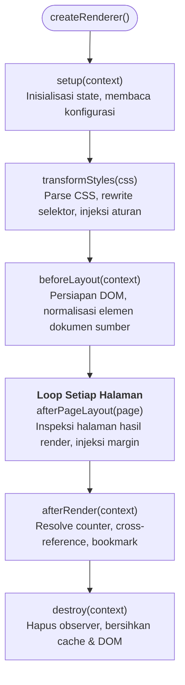

Printedjs mengadopsi arsitektur plugin modular dengan resolusi ketergantungan topologis. Fitur-fitur utama seperti `@page`, margin box, footnote, running header, dan counter diimplementasikan sebagai plugin yang dapat dikomposisikan. Anda dapat memperluas engine pagination ini dengan plugin kustom untuk memanipulasi stylesheet, menginjeksi konten, mengekstrak metadata dokumen, atau menerapkan aturan layout khusus.

## Interface `PrintedjsPlugin`

Plugin Printedjs adalah objek yang mengimplementasikan interface `PrintedjsPlugin` dari `@printedjs/core`:

```typescript
import type { PrintedjsPlugin, PluginContext, PageResult } from "@printedjs/core";

export interface PrintedjsPlugin {
	/** Identifier unik untuk plugin */
	name: string;

	/** Daftar opsional nama plugin yang harus dieksekusi sebelum plugin ini */
	dependencies?: string[];

	/** Dipanggil sekali sebelum transformasi style atau mount surface */
	setup?(context: PluginContext): void | Promise<void>;

	/** Mentransformasi teks CSS mentah atau AST sebelum diinjeksikan */
	transformStyles?(css: string, context: PluginContext): string | Promise<string>;

	/** Dipanggil setelah surface dimount namun sebelum pagination dimulai */
	beforeLayout?(context: PluginContext): void | Promise<void>;

	/** Dipanggil segera setelah setiap halaman selesai dipaginasi */
	afterPageLayout?(page: PageResult, context: PluginContext): void | Promise<void>;

	/** Dipanggil setelah seluruh halaman selesai dipaginasi dan diproses */
	afterRender?(context: PluginContext): void | Promise<void>;

	/** Hook pembersihan saat renderer.destroy() dipanggil */
	destroy?(context: PluginContext): void | Promise<void>;
}
```

---

## Urutan Eksekusi Lifecycle

Renderer mengeksekusi hook plugin sesuai urutan topologis yang deterministik:



---

## Contoh 1: Plugin Watermark Kustom

Berikut contoh praktis plugin yang menambahkan teks watermark diagonal "RAHASIA" di setiap halaman yang di-render:

```typescript
import type { PrintedjsPlugin, PluginContext } from "@printedjs/core";

export function watermarkPlugin(text: string = "RAHASIA"): PrintedjsPlugin {
	return {
		name: "watermark-plugin",
		dependencies: ["page-rules"], // Dijalankan setelah geometri halaman terbentuk

		transformStyles(css: string): string {
			const watermarkStyles = `
        .printedjs_watermark {
          position: absolute;
          inset: 0;
          display: flex;
          align-items: center;
          justify-content: center;
          font-size: 64pt;
          font-weight: 800;
          color: rgba(148, 163, 184, 0.15);
          transform: rotate(-35deg);
          pointer-events: none;
          user-select: none;
          z-index: 10;
        }
      `;
			return css + watermarkStyles;
		},

		afterPageLayout(page, context: PluginContext) {
			const doc = context.metadata["document"] as Document | undefined;
			if (!doc || !page.element) return;

			const pagebox = page.element.querySelector(".printedjs_pagebox") ?? page.element;
			const watermark = doc.createElement("div");
			watermark.className = "printedjs_watermark";
			watermark.textContent = text;
			pagebox.appendChild(watermark);
		},
	};
}
```

---

## Contoh 2: Plugin Ekstraktor Heading & Bookmark

Plugin ini mengekstrak semua elemen heading `<h1>` hingga `<h3>` dari seluruh halaman yang telah terbentuk dan menyimpannya ke dalam `context.metadata`:

```typescript
import type { PrintedjsPlugin, PluginContext } from "@printedjs/core";

export interface OutlineItem {
	level: number;
	title: string;
	id: string;
	pageNumber: number;
}

export function outlineExtractorPlugin(): PrintedjsPlugin {
	return {
		name: "outline-extractor",

		afterRender(context: PluginContext) {
			const doc = context.metadata["document"] as Document | undefined;
			if (!doc) return;

			const outline: OutlineItem[] = [];
			const pages = doc.querySelectorAll<HTMLElement>(".printedjs_page");

			pages.forEach((pageEl, pageIdx) => {
				const headings = pageEl.querySelectorAll<HTMLHeadingElement>("h1, h2, h3");
				headings.forEach((h) => {
					outline.push({
						level: Number(h.tagName.substring(1)),
						title: h.textContent?.trim() ?? "",
						id: h.id || `heading-${outline.length}`,
						pageNumber: pageIdx + 1,
					});
				});
			});

			// Simpan hasil outline ke metadata untuk dikonsumsi pemanggil
			context.metadata["documentOutline"] = outline;
		},
	};
}
```

---

## Mendaftarkan Plugin ke Renderer

Kirimkan plugin kustom Anda ke dalam opsi `plugins` di `createRenderer`:

```typescript
import { createRenderer } from "@printedjs/browser";
import { standardPreset } from "@printedjs/plugins";
import { watermarkPlugin } from "./watermark-plugin";
import { outlineExtractorPlugin } from "./outline-plugin";

const renderer = createRenderer({
	target: document.querySelector("#preview")!,
	plugins: [...standardPreset(), watermarkPlugin("DRAFT"), outlineExtractorPlugin()],
});

const result = await renderer.render({ content: { html } });
```
