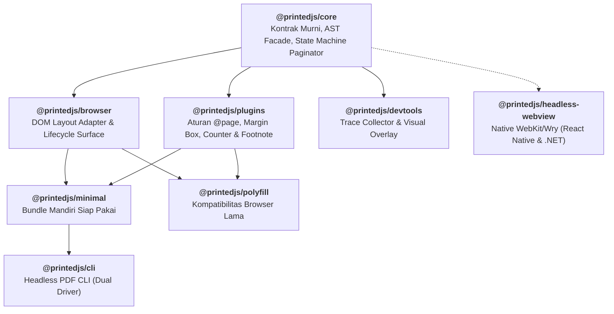
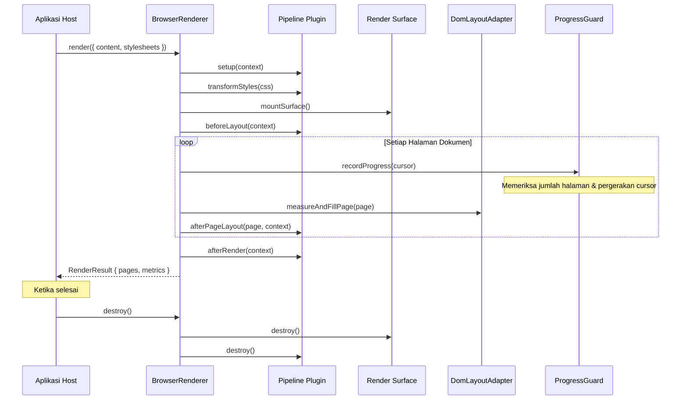

Printedjs adalah engine TypeScript modular berperforma tinggi untuk rendering dokumen berhalaman (paginated) secara browser-native. Menggantikan Paged.js monolitik dengan arsitektur multi-package, pemisahan tanggung jawab yang tegas, pencegahan infinite loop, serta kepatuhan penuh terhadap standar CSS Paged Media.

## 1. Prinsip Desain Arsitektur

Printedjs dibangun di atas empat pilar utama:

1. **Arsitektur Core Terpisah (`@printedjs/core`):** State machine murni, penanganan error, analisis AST CSS (`css-tree`), dan kontrak paginator berada dalam package core agnostik tanpa ketergantungan pada `window`, `document`, atau CSSOM browser. Layout, pengukuran geometri, dan manipulasi DOM diisolasi secara bersih di `@printedjs/browser` yang dieksekusi di runtime browser atau headless WebView.
2. **Isolasi Surface:** Dokumen yang di-render tidak boleh mengotori aplikasi host. Mendukung eksekusi in-place (`root`) dan sandboxed (`iframe`) dengan jaminan pembersihan bersih tanpa residu.
3. **Resilient Pagination Guard:** Dokumen dengan aturan break yang saling bertentangan atau blok besar yang meluap tidak akan membuat tab browser hang atau mengalami infinite loop.
4. **Pipeline Plugin Topologis:** Fitur-fitur seperti margin box, running header, footnote, dan counter diimplementasikan sebagai plugin terpisah dengan resolusi ketergantungan topologis.

---

## 2. Peta Package Monorepo

---

## 3. Urutan Siklus Hidup Rendering

Diagram urutan berikut mengilustrasikan alur operasi yang terjadi selama pemanggilan render:

---

## 4. Konvensi DOM & CSS

- **Shell Halaman:** Setiap kotak halaman tersusun atas pembungkus terluar `.printedjs_page`, yang berisi `.printedjs_sheet`, `.printedjs_pagebox`, dan margin box standar (`.printedjs_margin-top-left`, dll.).
- **Variabel CSS:** Dimensi lembar, bleed, dan margin disimpan dalam CSS custom property standar (contoh: `--printedjs-width`, `--printedjs-height`, `--printedjs-margin-top`).
- **Mode Kompatibilitas:** Saat `pagedjsCompatible: true` diaktifkan, Printedjs memancarkan class modern `.printedjs_*` sekaligus class lama `.pagedjs_*`, menjamin kompatibilitas penuh dengan stylesheet cetak yang sudah ada.
