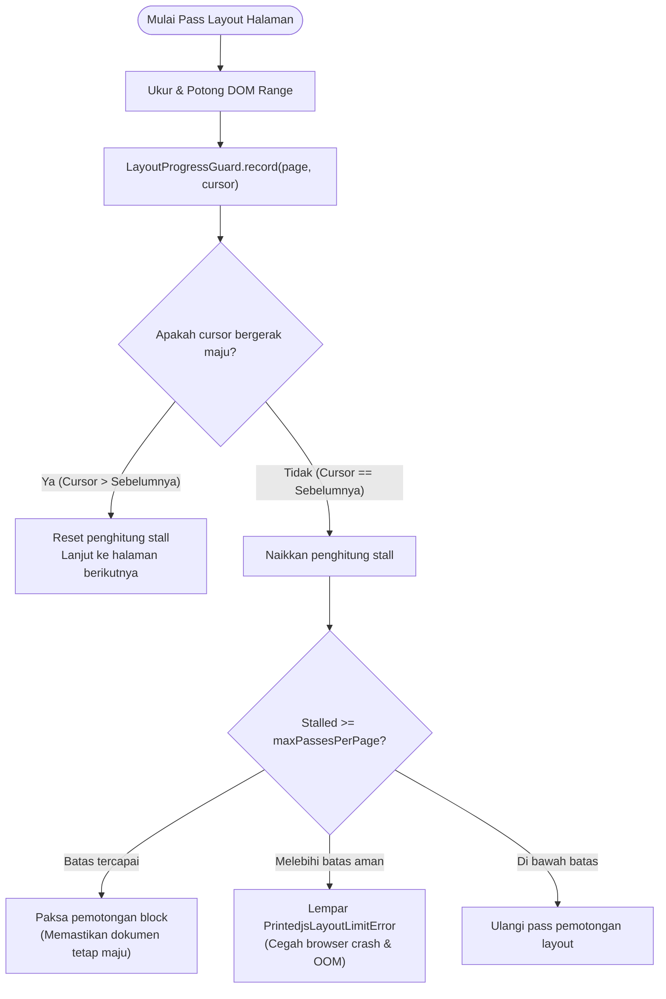

Penyebab utama tab browser mengalami hang atau crash pada engine pagination lama (seperti Paged.js monolitik) adalah infinite loop saat pembuatan halaman. Printedjs menyelesaikan masalah ini secara mendasar melalui state machine core `LayoutProgressGuard`.

## Masalah Infinite Loop pada Dokumen

Pada dokumen nyata yang kompleks, kombinasi aturan CSS yang bertentangan sering menghasilkan kondisi pagination yang mustahil dipenuhi:

1. **Elemen Unbreakable yang Terlalu Tinggi:** Baris tabel, blok kode, atau gambar dengan aturan `break-inside: avoid` yang memiliki tinggi melebihi tinggi printable area halaman (`page-height - margins`).
2. **Aturan Break Siklik:** Aturan kontradiktif seperti `h2 { break-before: avoid }` yang langsung diikuti oleh elemen saudara dengan `break-before: page`.
3. **Break Token Tanpa Kemajuan (Zero-Advance):** Sebuah elemen dipindahkan ke halaman berikutnya karena tidak muat di halaman saat ini, namun di halaman baru yang kosong pun elemen tersebut tetap tidak muat, sehingga engine terus-menerus membuat ribuan halaman kosong hingga memori browser habis.

---

## Cara Kerja `LayoutProgressGuard`

`LayoutProgressGuard` bertindak sebagai supervisor aktif di dalam perulangan pagination:



---

## Mekanisme Perlindungan

### 1. Pelacakan Cursor & Break Token

Setelah setiap pass pemotongan layout, `LayoutProgressGuard` mencatat offset node DOM absolut dan posisi karakter teks. Jika posisi cursor tidak bergeser maju dibandingkan pass sebelumnya, guard akan menaikkan counter stall internal.

### 2. Pemaksaan Break (Forced Break) & Pemotongan Overflow

Ketika sebuah elemen dengan `break-inside: avoid` memiliki tinggi melebihi satu halaman penuh kosong, penerapan aturan CSS secara kaku akan menghentikan seluruh pagination. Daripada mengalami infinite loop, guard akan melonggarkan batasan avoid tersebut dan memotong elemen secara aman agar pagination dokumen dapat terus berlanjut.

### 3. Batas Ambang yang Dapat Dikonfigurasi

Developer dapat menyesuaikan batas keamanan pada konfigurasi renderer:

```typescript
const renderer = createRenderer({
	target: container,
	plugins: standardPreset(),
	limits: {
		maxPages: 500, // Batas maksimal halaman sebelum melempar error
		maxPassesPerPage: 10, // Maksimal percobaan pass per halaman
	},
});
```

---

## Hirarki Error Bertipe

Printedjs mengekspor taksonomi class error bertipe yang diturunkan dari `PrintedjsError`:

```typescript
import {
	PrintedjsError,
	PrintedjsLayoutLimitError,
	PrintedjsInputError,
	PrintedjsStylesheetError,
	PrintedjsAbortError,
} from "@printedjs/core";

try {
	await renderer.render({ content: { html } });
} catch (error) {
	if (error instanceof PrintedjsLayoutLimitError) {
		console.error(
			`Batas layout terlampaui: ${error.message} (Batas halaman: ${error.limit})`,
		);
	} else if (error instanceof PrintedjsAbortError) {
		console.warn("Proses render dibatalkan via AbortSignal");
	} else if (error instanceof PrintedjsStylesheetError) {
		console.error(`Gagal parsing CSS pada stylesheet: ${error.url}`);
	}
}
```
