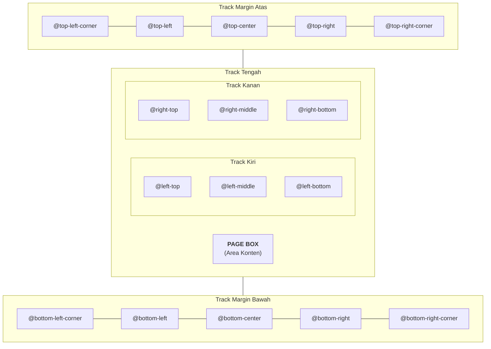

At-rule `@page` mendefinisikan dimensi halaman, margin, batas bleed, crop mark, dan area margin box perimeter pada dokumen fisik.

## Ukuran & Orientasi Halaman

Definisikan geometri halaman dasar di CSS:

```css
@page {
	/* Ukuran kertas standar dan orientasi */
	size: A4 portrait; /* atau 'letter', 'legal', 'A3', 'landscape' */

	/* Margin halaman */
	margin: 25mm 20mm 25mm 20mm;

	/* Bleed cetak dan crop mark */
	bleed: 3mm;
	marks: crop cross;
}
```

::feature-preview{feature="page-rules-basic"}
::

### Ukuran Kertas yang Didukung

Printedjs mendukung keyword ukuran standar maupun dimensi kustom:

- **Ukuran Standar:** `A4`, `A3`, `A5`, `letter`, `legal`, `ledger`.
- **Dimensi Kustom:** `size: 210mm 297mm;` atau `size: 8.5in 11in;`.
- **Orientasi:** `portrait` (default) atau `landscape` (contoh `size: letter landscape`).

---

## Pseudo-Class Halaman & Spreads

Printedjs mendukung pseudo-class halaman W3C untuk format buku dan majalah:

```css
/* Halaman cover: tanpa margin, tanpa header atau footer */
@page :first {
	margin: 0;
	@top-left {
		content: none;
	}
	@bottom-right {
		content: none;
	}
}

/* Halaman kiri (verso / genap) */
@page :left {
	margin-left: 30mm; /* Margin luar lebih lebar */
	margin-right: 20mm; /* Gutter jilid */
	@bottom-left {
		content: counter(page);
	}
}

/* Halaman kanan (recto / ganjil) */
@page :right {
	margin-left: 20mm; /* Gutter jilid */
	margin-right: 30mm; /* Margin luar lebih lebar */
	@bottom-right {
		content: counter(page);
	}
}

/* Halaman kosong yang disisipkan otomatis */
@page :blank {
	@top-center {
		content: "Halaman ini sengaja dikosongkan";
		font-style: italic;
		color: #94a3b8;
	}
}
```

---

## 16 CSS Margin Box

Spesifikasi W3C CSS Paged Media mendefinisikan 16 margin box perimeter di sekeliling area cetak dokumen:



::feature-preview{feature="page-rules-margins"}
::

### Contoh Penggunaan Margin Box

```css
@page {
	size: letter;
	margin: 20mm 18mm;

	@top-left {
		content: "Laporan Audit Internal";
		font-size: 8pt;
		font-weight: 600;
		color: #64748b;
	}

	@top-right {
		content: string(chapter-title);
		font-size: 8pt;
		color: #64748b;
	}

	@bottom-left {
		content: "Distribusi: Khusus Internal";
		font-size: 7.5pt;
		color: #ef4444;
	}

	@bottom-right {
		content: "Halaman " counter(page) " dari " counter(pages);
		font-size: 8pt;
		font-weight: 500;
		color: #0284c7;
	}
}
```
